

<b>العربية</b> · <a href="#english">English</a>

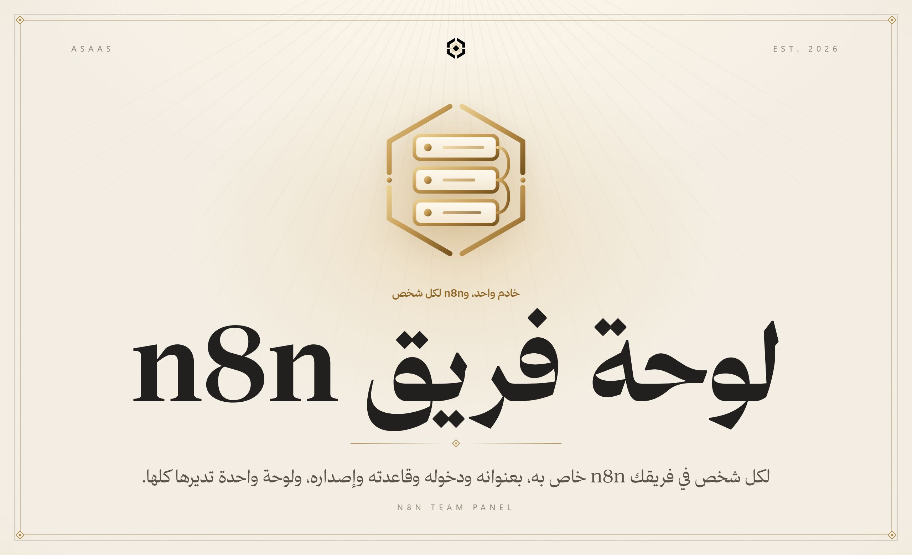

 

n8n المشترك يعمل حتى يتوقف: أحدهم يعدّل مسارًا ليس له، وآخر يحتاج إصدارًا أحدث يكسر عُقد غيره، ومسار واحد جامح يلتهم الذاكرة فيتوقف الجميع. الحل المعتاد n8n لكل شخص، لكنه يدويًا يعني منافذ وملفات compose ومفاتيح تشفير ومسارات وكيل عكسي وشهادات وحسابات مالكين، ثم تذكّر كل ذلك عند التحديث والنسخ الاحتياطي. هذه اللوحة تفعل كل ذلك عنك: تكتب اسمًا وبريدًا، وبعد دقيقة يكون للشخص n8n خاص به على عنوانه.

 

<b>الكود في مستودع خاص</b> هذه واجهة العرض العامة لـ«لوحة فريق n8n». الكود المصدري محفوظ في مستودع خاص، والمساهمة فيه متاحة بدعوة. <a href="https://alaadin-alynaey.site/">تواصل لطلب الوصول أو المساهمة</a>

 

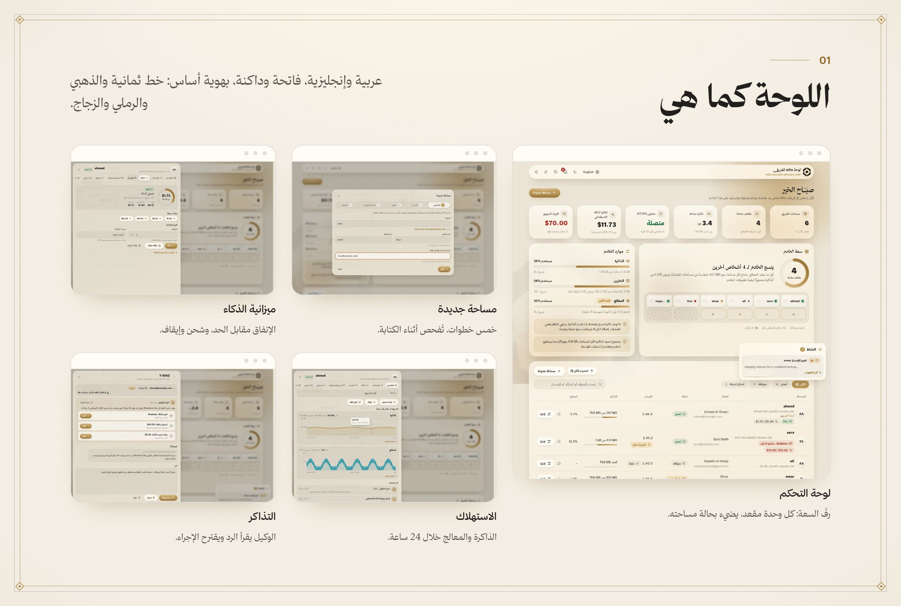

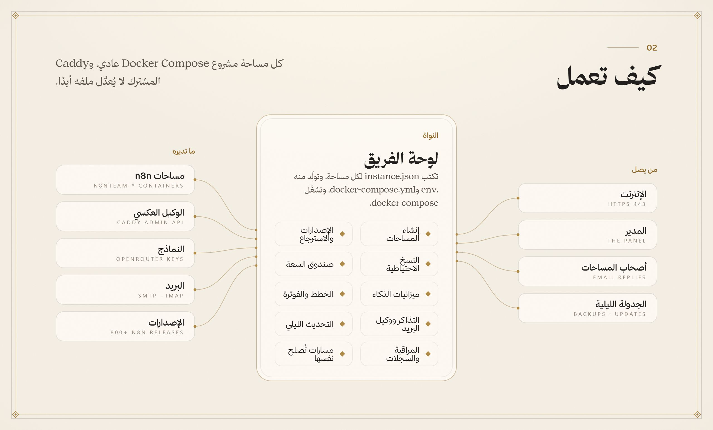

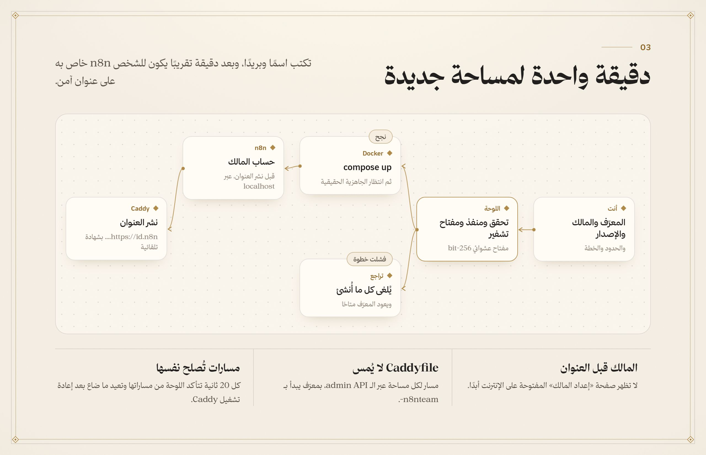

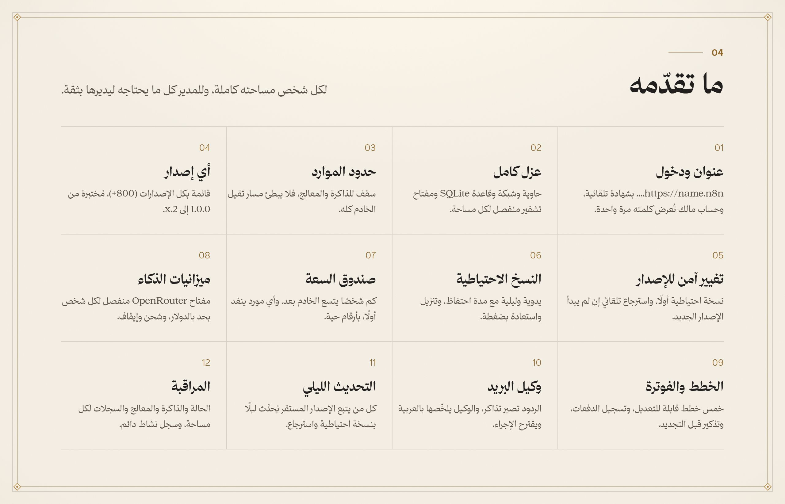

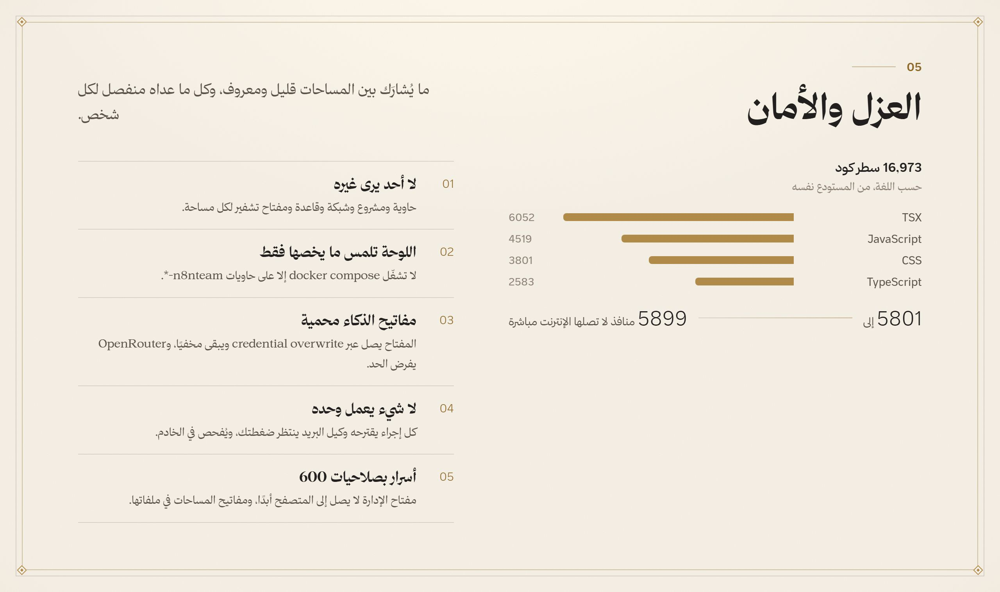

<a href="#arabic">العربية</a> · <b>English</b>

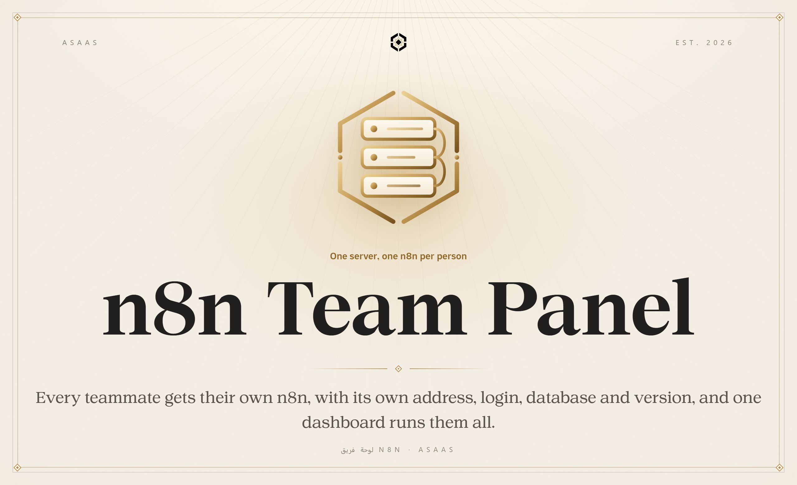

 

A shared n8n works until it doesn’t: someone edits a workflow that isn’t theirs, one person needs a newer version that breaks another’s nodes, or one runaway workflow eats all the memory and everything stops. The usual fix is one n8n per person, but by hand that means ports, compose files, encryption keys, reverse-proxy entries, certificates and owner accounts, and remembering all of it for upgrades and backups. This panel does it all: type a name and an email, and a minute later that person has their own n8n at their own address.

 

<b>The source lives in a private repository</b> This is the public showcase of n8n Team Panel. The source code is kept private, and contributions are open by invitation. <a href="https://alaadin-alynaey.site/">Get in touch for access or to contribute</a>

 

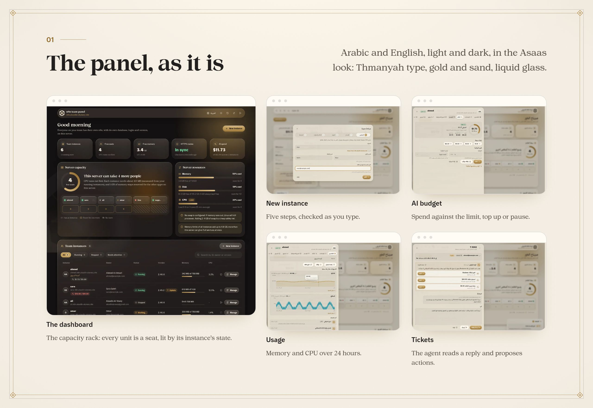

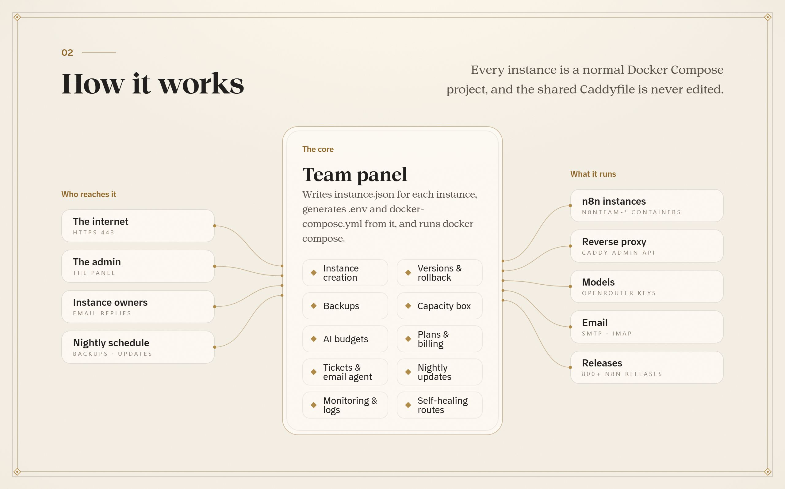

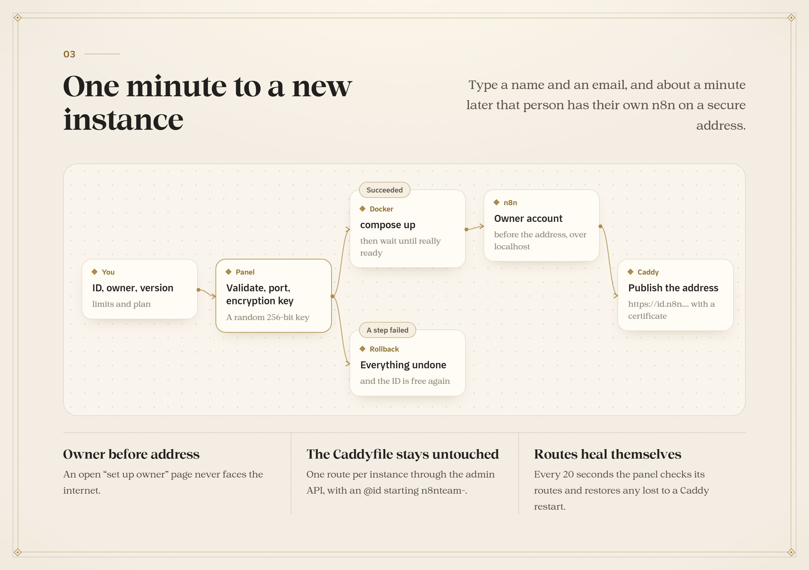

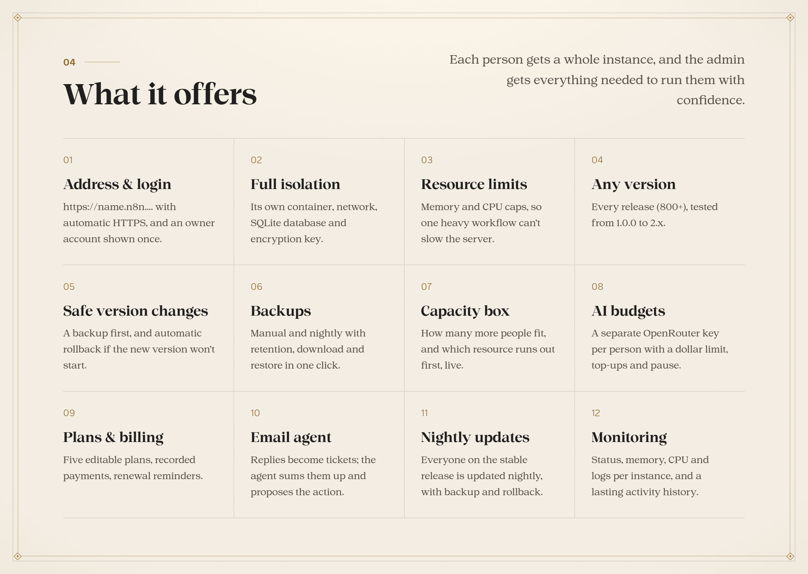

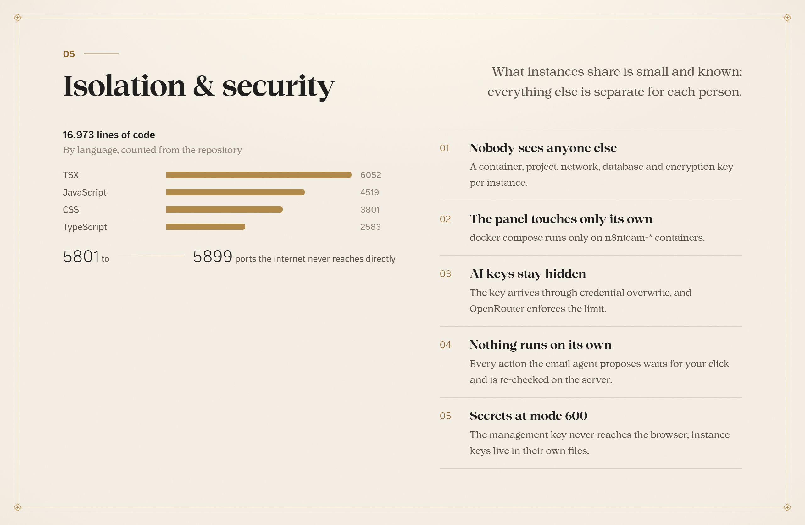

  جزء من منظومة <b>أساس</b> · Part of the <b>Asaas</b> ecosystem
   
  من تصميم وبناء <a href="https://github.com/AladdinAlynaey">علاء الدين</a> · Designed and built by <a href="https://github.com/AladdinAlynaey">Alaadin</a>
   
  © 2026 · جميع الحقوق محفوظة · All rights reserved

